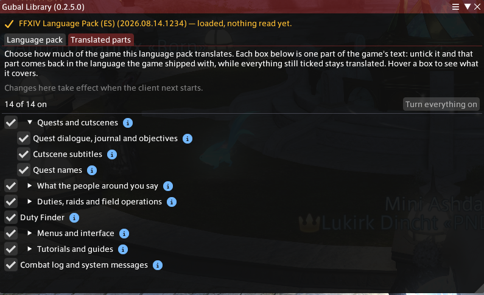
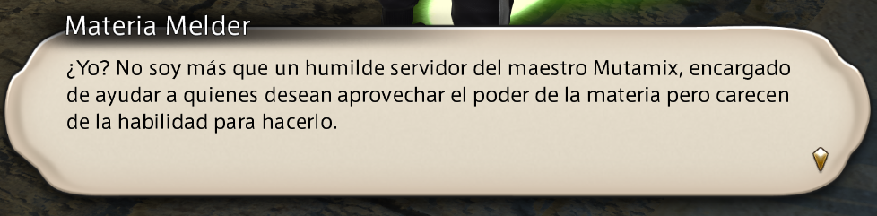
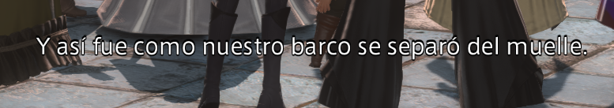
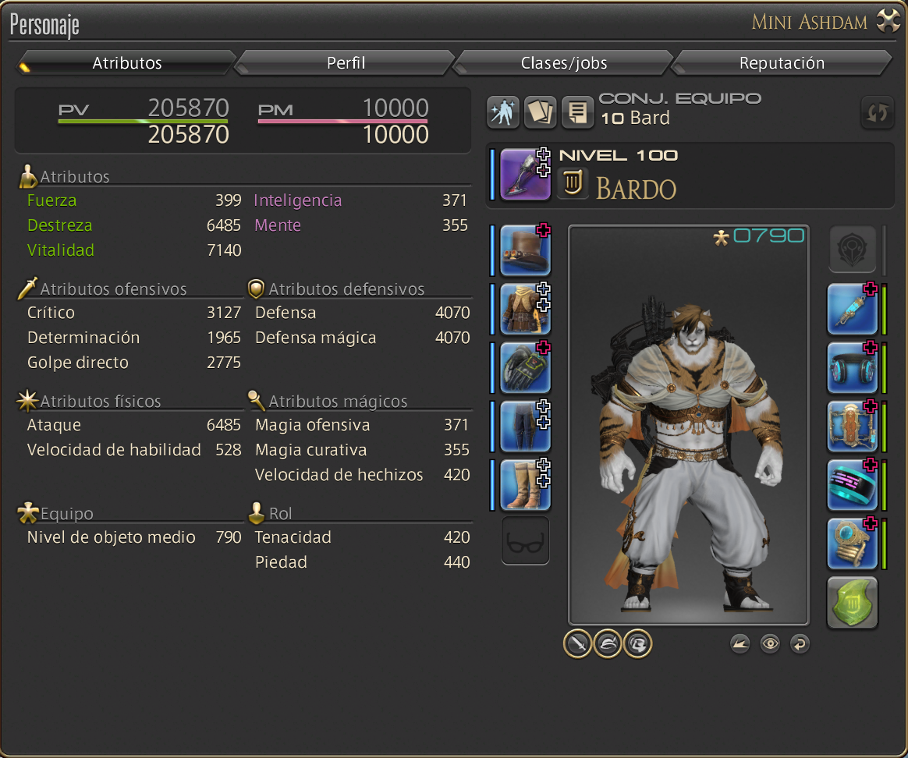
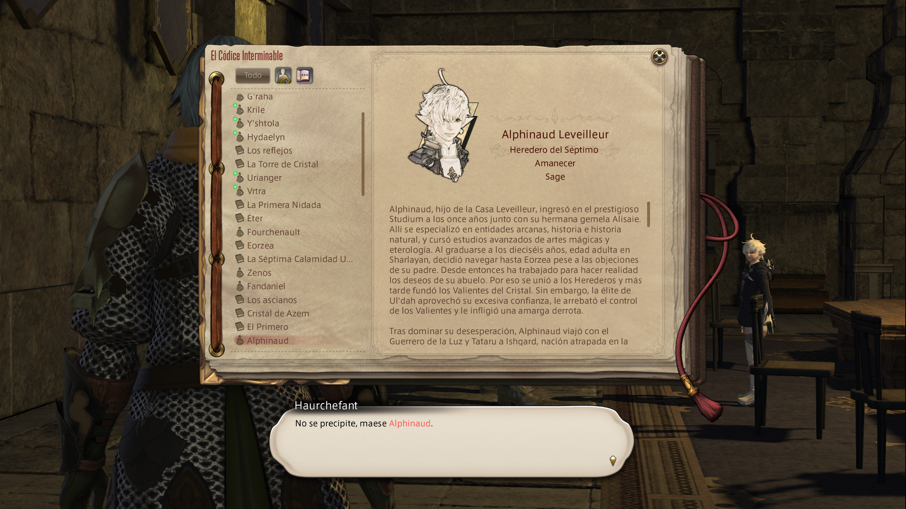

# Gubal Library

*Community language localizer for FFXIV.*

A Dalamud plugin that hands the game pre-translated copies of its own text files. The game draws them
itself, with its own font, its own typewriter reveal and its own line breaks, so italics, colour and
gender agreement all survive. **Your game install is never modified.**

Named for the Great Gubal Library, Sharlayan's repository of all written knowledge.

The plugin lists the packs the community publishes, and downloads the one you pick from the address its own maintainers gave. Any language works.

## Language packs

**Players:** pick your language at **[eorzealocalized.com](https://eorzealocalized.com/)**. Each language has its own page with the install steps, the coverage and where to report a wrong line.

**Translators:** the **[localization guide](https://eorzealocalized.com/localize/en.html)** explains how a pack is built, for a language that has one and for one that does not yet. Questions go to [Discussions](https://github.com/ashdam/gubal-library/discussions).

## Examples

The live game with a Spanish pack installed. Not a mock-up and not an overlay: the game read those
words out of a file and drew them natively.












## Install

Gubal-library is a Dalamud plugin therefore Dalamud needs to be [downloaded](https://goatcorp.github.io/) and installed .

**In Dalamud:**

1. **Add gubal-library repository.** Go to Dalamud settings or write `/xlsettings` in the chat then go to **Experimental**. Go to **Custom Plugin Repositories** box, press **+**, tick *Enabled*, **Save and Close**:

   ```
   https://raw.githubusercontent.com/ashdam/gubal-library/main/repo.json
   ```

2. **Install the plugin.** `/xlplugins` → search **Gubal Library** → **Install**.

3. **Install a language pack.** Open Gubal or write `/gubal` in the chat → pick yours under *Language* → **Install**. Building one
   yourself? Pick *a pack of your own* and point it at your build folder; nothing is copied.

4. **Restart the client.** Not optional: the game reads its text once, seconds into startup, and
   keeps it for the session. A pack switched on mid-game changes nothing until the next start.

**Keep your language pack updated.** The plugin keeps your language pack update when a newer one exists. You can also configure the auto-update feature to save a restart whenever there is an update.


## What gets translated

Whatever the pack covers, and there is no list of supported windows — that is the point of doing it
this way. Dialogue, quest journal, cutscene subtitles, speech balloons, menus, item names, tooltips
and log messages all come out of the game's Excel sheets, so all of them are reached.

**You can turn parts of it off.** The *Localization settings* tab lists what the installed pack holds,
with a checkbox each and a note on what switching it off costs. Switching a part off does not blank
it: the pack replaces the game's own English, so that English is what comes back.

Language packs can include `.uld` layout files under `ui/uld/`, for example
`ui/uld/xbmmonsterbookdetail.uld`. Gubal serves them while the Addon translation is enabled
and the pack matches the game version. Restart the client after an update.
The pack is blocked if its game version differs or cannot be checked. Pack updates remain available while blocked.

## How this compares

| | Well-known plugin<br><sub>translated as it appears, drawn over the game</sub> | Mod-loader text packs<br><sub>the game's pages, applied by a mod loader</sub> | **Gubal Library**<br><sub>the game's pages, served by the plugin</sub> |
|---|:---:|:---:|:---:|
| **What else you must install** | a translation service,<br>usually with an API key | mod loader (Penumbra) | ✅ **nothing** |
| **The game lays the text out** | ❌ drawn on top | ✅ Native | ✅ Native |
| **Gender and number agree** | ❌ not considered | ✅ Native | ✅ Native |
| **Network traffic while you play** | ❌ every line | ✅ none | ✅ none |
| **Consistent from one line to the next** | ❌ each line alone | ✅ | ✅ glossary, enforced by a validator |
| **Choose what stays in English** | ➖ | ✅ by category | ✅ by category/subcategory |
| **Your game files untouched** | ✅ | ✅ | ✅ |


## Commands

### Dialogue Codex links

In `/gubal` → **Unending Codex**, enable dialogue links. Names of unlocked
Codex entries become links in the `Talk` window. The option takes effect without a restart.
Names must match the Codex list, including full names. Text inside an existing link is not changed.

Click a highlighted name in NPC dialogue or a cutscene to open its entry without advancing the dialogue.
Click outside a name to advance the dialogue. Links use the native game cursor and require no modifier key.

### Chat commands

| Command | Effect |
|---|---|
| `/gubal` | Open the settings window |
| `/gubal status` | The installed pack, its version, coverage, and reads answered this session |
| `/gubal parts` | Which parts of the translation are switched on, by group |
| `/gubal check` | Ask now whether a newer pack is published, and say either way |
| `/gubal usepack` | Toggle: the pack or the game's own English, from the next start. The way back when the settings window cannot be reached |
| `/gubal autoupdate` | Toggle: the startup fetch, along with Dalamud's wait for plugins |
| `/gubal debug on` / `off` | Trace lines in the log, and a line per page and font the game reads. Off, the plugin logs only warnings and errors. Chat only, there is no checkbox |
| `/gubal dev` | Toggle the Dev tab and save the setting. Off by default. Works with installed releases and development builds. |

`/gubal debug` toggles diagnostics immediately. `/gubal debug on` and `/gubal debug off` set the state explicitly. Probes run only while debug is enabled.
It exists to check that the plugin still attaches before the game's first read, which is the
one property this whole approach depends on.

### Dev tab

Run `/gubal dev` to enable the Dev tab. Run it again to disable the tab and stop its previews.
The setting persists across restarts and does not depend on Dalamud's Dev Plugin Locations.
Use the tab to compare original game banners with the active pack's translations through native game presentation,
and preview the plugin update notice.

The installed pack supplies `dev/banner-translations.json` for labels and `dev/banner-native-scenes.json`
for native presentations. Tools exports the scene catalog to game-sheets metadata and PackBuilder includes it.
Gubal reads the parameters without discovering associations from game sheets or native tables.
The catalog must match the running game version. Unresolved textures remain listed without native previews.
No separate download is required.

## Development

`Gubal.slnx` contains the plugin and Desktop. `Directory.Build.props` sets their shared version.

| Project | Purpose |
| --- | --- |
| `Gubal.Core` | Pack installation, updates, compatibility and usage reports. |
| `Gubal.Game` | Shared texture loading and native resource paths. |
| `Gubal.Plugin` | Dalamud services and the in-game interface. |
| `Gubal.Desktop` | Windows Forms interface and Desktop settings. |
| `Gubal.Runtime` | File redirection inside FFXIV without Dalamud. |
| `Gubal.Launcher` | Official launcher startup and runtime loading. |

Set `DALAMUD_HOME` to the downloaded Dalamud distribution for its SDK and dependency assemblies.
Local builds also accept the XIVLauncher development distribution. Core and Runtime do not load Dalamud.

The build embeds `../ffxiv-corpus-en/config/sheet-category-tree.json` for localization categories and sheet switches.
Use `-p:LocalizationTreePath=<path>` for another source. The installed application does not read the source file.
CI fetches the tree from `ffxiv-corpus-en/main`. Merge tree changes there before releasing Gubal.
Nodes supply English names and optional descriptions. Target UI locales use `Tree.<ID path>.Name` and
`Tree.<ID path>.Description`, with dots between IDs. Missing translations use the English source text.

Category screenshots use the same ID path under `images/tooltips`: `story.questtext.png`, or
`story.questtext.1.png`, `.2.png` for multiple images. Missing part images use group images when present; otherwise no image is shown.

```powershell
dotnet build src/Gubal.Plugin/GubalLibrary.csproj -c Release
dotnet build Gubal.slnx -c Release
dotnet build src/Gubal.Desktop/Gubal.Desktop.csproj -c Release -t:Package
```

The plugin builds to `bin/x64/Release/win-x64`. Desktop builds to
`src/Gubal.Desktop/bin/x64/Release/net10.0-windows/win-x64`.
Runtime builds its native host with the pinned Zig compiler and checks the download's SHA-256 hash.

The Desktop `Package` target creates the portable ZIP and update feed in `dist/desktop`, with .NET included.
The Dalamud package is `bin/x64/Release/win-x64/GubalLibrary/latest.zip` and contains no Desktop files.
Desktop stores packs and settings in `%LOCALAPPDATA%/GubalDesktop`. Its reporting identity is separate from the plugin.
In Desktop settings, select Steam and Free Trial to match the account license. These options apply to English and localized launches. The installation folder does not select the account type. Keep Steam open for Steam accounts.
The same settings dialog opens at first startup. It lists detected installations and selects Steam when a matching Steam app manifest confirms the folder. Free Trial is selected by the user.
Plugin and Desktop errors are queued locally and sent with a startup report from a later session. Error capture does not start a network request. Reports contain bounded diagnostics, not complete logs; paths, URLs and credential fields are redacted.

GitHub Actions builds both Windows packages with the Linux .NET SDK on Ubuntu.
Release checks use Bash and jq. Their tests are defined in the release checks workflow.

Desktop uses Velopack and GitHub Releases for application updates. It applies updates only while FFXIV is closed.
Package versions map `0.7.5.0` to `0.7.5-rev.0`; the interface keeps the four-part application version.
For local update checks, set `GUBAL_DESKTOP_UPDATE_SOURCE` to a directory containing the generated update feed.
