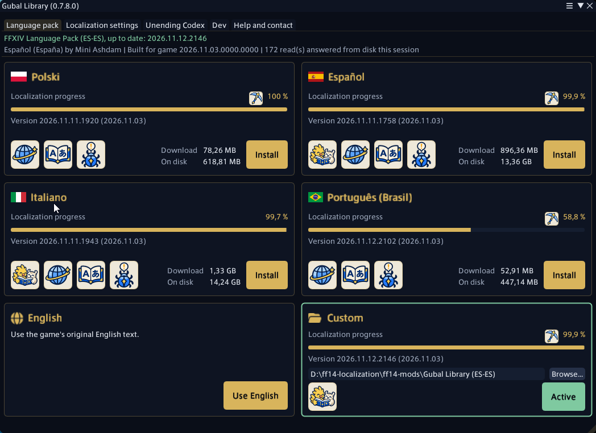

# Gubal Library

Community language packs for FFXIV, available as a Dalamud plugin and a Windows x64 Desktop app.
The game displays the translated text, layouts and images. Game files are not modified.

Find language packs, coverage and translation support at **[eorzealocalized.com](https://eorzealocalized.com/)**.
To create or maintain a pack, see the [localization guide](https://eorzealocalized.com/localize/en.html).



<details>
<summary>In-game examples with the Spanish pack</summary>


</details>

## Install

### Dalamud plugin

1. Install [XIVLauncher and Dalamud](https://goatcorp.github.io/).
2. In `/xlsettings` → **Experimental** → **Custom Plugin Repositories**, add and enable:

   ```text
   https://raw.githubusercontent.com/ashdam/gubal-library/main/repo.json
   ```

3. Open `/xlplugins` and install **Gubal Library**.
4. Open `/gubal`, install a language pack and restart FFXIV.

### Desktop

1. Download the portable ZIP from [Releases](https://github.com/ashdam/gubal-library/releases/latest), extract it and open `GubalDesktop.exe`.
2. Select the game folder and account options. Steam is detected from its installation manifest when possible; select **Free Trial** if applicable. Keep Steam open for Steam accounts.
3. Select a language, install its pack and start FFXIV from Gubal. Sign in through the official launcher and keep Gubal open until it reports **Translation loaded**.

Desktop includes .NET and works without Dalamud. Close FFXIV and its launchers before installing a pack or applying a Desktop update.
Both clients accept a local pack folder through **Custom**.

## Features

- Translates the text and assets supplied by the selected pack. The plugin can enable or disable translation categories; changes apply after a game restart.
- After a game update, compatible pack resources can remain active; incompatible resources use the originals. Required resource failures can block the pack.
- Shows the original English item name below the translated name.
- Partial market searches accept translated and English names, ignore case and accents, and keep `n` and `ñ` distinct.
- The plugin adds **Copy English name** to inventory item context menus and offers optional **Unending Codex** links in dialogue.

## Plugin commands

| Command | Action |
| --- | --- |
| `/gubal` | Open settings. |
| `/gubal debug on` / `off` | Enable or disable diagnostic logging. |
| `/gubal dev` | Toggle the Dev tab; disabled by default. |

Dev compares original and translated banners through native game presentation. It uses the active pack's
`dev/banner-translations.json` and `dev/banner-native-scenes.json`; the scene catalog must match the game version.

## Support and data

Report plugin or Desktop problems in [Issues](https://github.com/ashdam/gubal-library/issues).
Report translation problems to the relevant language pack, linked from the website.

- Plugin log: `%APPDATA%/XIVLauncher/dalamud.log`.
- Desktop settings, packs and logs: `%LOCALAPPDATA%/GubalDesktop`.
- Errors are saved locally and sent with a later startup report. Reports contain bounded, redacted diagnostics rather than complete logs.
